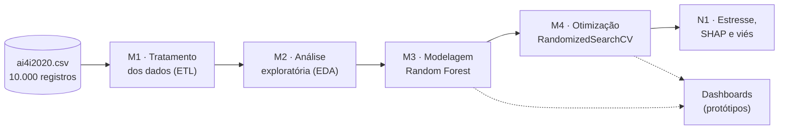
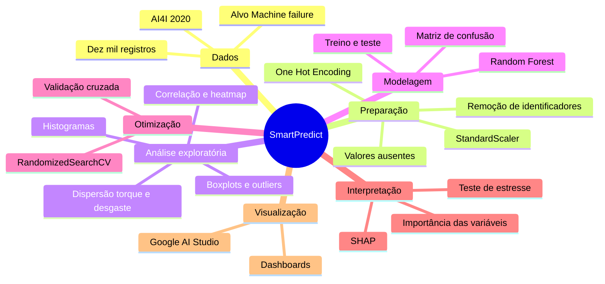
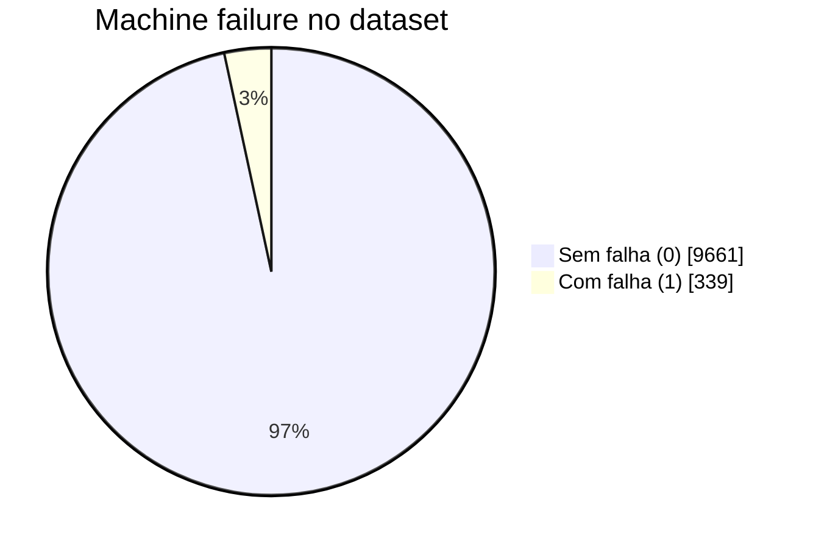
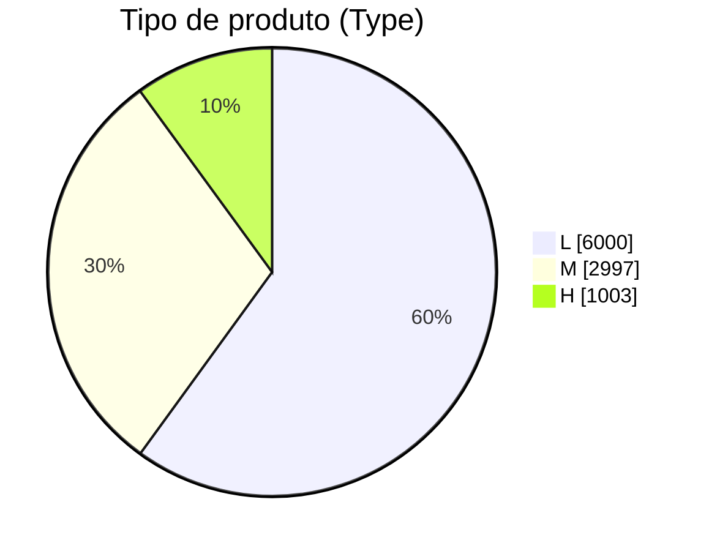
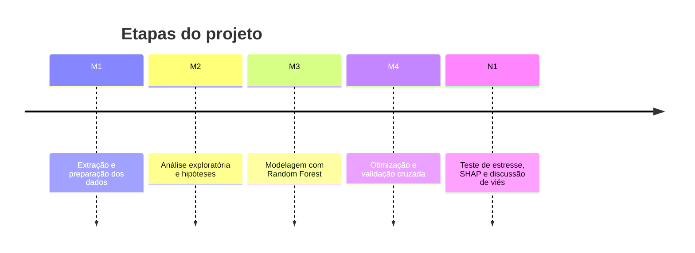
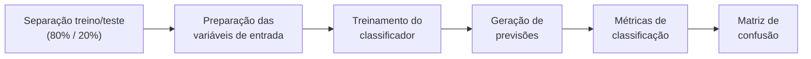
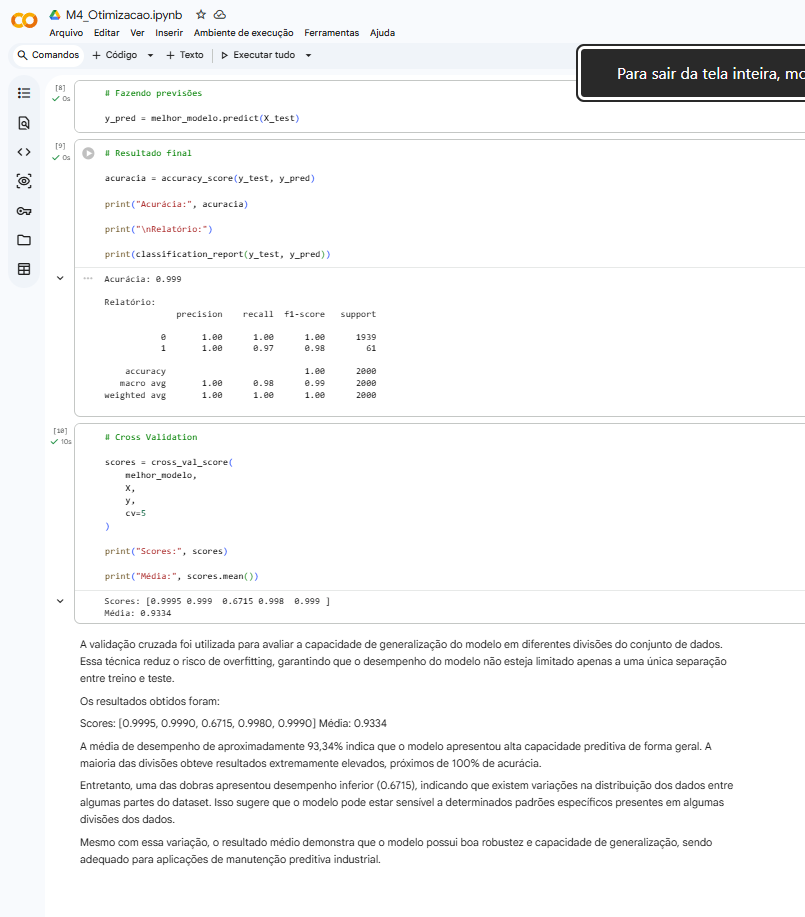

# SmartPredict | Manutenção Preditiva com Machine Learning

<p align="center">
  
  
  
  
  
</p>
<p align="center">
  
  
  
  
  
  
</p>
<p align="center">
  
  
  
  
  
</p>

<p align="center">
  Solução analítica para <b>previsão de falhas industriais</b> por meio de análise exploratória, tratamento de dados,
  modelagem preditiva e avaliação de algoritmos de Machine Learning.
</p>

<p align="center">
  <a href="#-visão-geral">Visão Geral</a> •
  <a href="#-problema-e-objetivos">Problema</a> •
  <a href="#-fonte-de-dados">Dados</a> •
  <a href="#-pipeline-de-ciência-de-dados">Pipeline</a> •
  <a href="#-resultados-experimentais">Resultados</a> •
  <a href="#-dashboard-de-monitoramento">Dashboard</a> •
  <a href="#-notebooks">Notebooks</a> •
  <a href="#-tecnologias-e-ferramentas">Tecnologias</a>
</p>

---

## 📌 Visão Geral

O **SmartPredict** é um projeto de Ciência de Dados e Inteligência Artificial voltado à **manutenção preditiva
industrial**, utilizando dados operacionais para investigar padrões associados à ocorrência de falhas em equipamentos.

A solução utiliza o conjunto de dados **AI4I 2020**, que reúne variáveis relacionadas às condições de operação de
máquinas, permitindo estudar a relação entre parâmetros técnicos e a ocorrência de falhas.

O fluxo de desenvolvimento abrange preparação dos dados, análise exploratória, investigação estatística, treinamento
de modelos, otimização de hiperparâmetros e avaliação dos resultados.



## 🧠 Mapa Mental do Projeto



## 🎯 Problema e Objetivos

Falhas inesperadas em equipamentos industriais podem provocar **interrupções operacionais, custos de manutenção e
redução da disponibilidade dos ativos**. A manutenção preditiva utiliza dados operacionais e técnicas analíticas para
identificar padrões associados a situações de risco, oferecendo subsídios para decisões de manutenção.

<table>
  <tr>
    <th>🔧 Variáveis investigadas</th>
    <th>🎯 Objetivos</th>
  </tr>
  <tr>
    <td valign="top">

- 🌡️ Temperatura do ar
- 🔥 Temperatura do processo
- 🔄 Velocidade de rotação
- ⚙️ Torque
- 🛠️ Desgaste da ferramenta
- 🏷️ Tipo de produto

</td>
    <td valign="top">

- Explorar e compreender os dados operacionais.
- Identificar relações estatísticas entre variáveis e falhas.
- Preparar os dados para treinamento de modelos.
- Construir um classificador de falhas com Random Forest.
- Investigar a importância das variáveis preditoras.
- Otimizar hiperparâmetros e avaliar a generalização do modelo.
- Apresentar os resultados por meio de visualizações e protótipos de dashboard.

</td>
  </tr>
</table>

## 📦 Fonte de Dados

O projeto utiliza o **AI4I 2020 Predictive Maintenance Dataset**, disponibilizado no Kaggle:
👉 [Consultar o dataset AI4I 2020 no Kaggle](https://www.kaggle.com/datasets/stephanmatzka/predictive-maintenance-dataset-ai4i-2020)

O conjunto possui aproximadamente **10 mil registros** (10.000 linhas no arquivo [`data/ai4i2020.csv`](data/ai4i2020.csv))
e reúne informações operacionais utilizadas na investigação de falhas de máquinas.

**Variável-alvo:** `Machine failure` — indica a ocorrência de falha, permitindo formular o problema como uma tarefa
de **classificação supervisionada**.

A distribuição real do arquivo mostra o forte desbalanceamento entre as classes e entre os tipos de produto:





## 🔄 Pipeline de Ciência de Dados



<details open>
<summary><b>1️⃣ Extração e preparação dos dados</b></summary>

Os dados são carregados em Python a partir de arquivos CSV, utilizando Pandas para manipulação e preparação.

- Remoção de identificadores que não contribuem diretamente para a previsão (`UDI` e `Product ID`).
- Verificação de valores ausentes (nenhum nulo encontrado).
- Codificação de variáveis categóricas com One-Hot Encoding (`Type` → `Type_H`, `Type_L`, `Type_M`).
- Preparação dos atributos numéricos (padronização com `StandardScaler`).
- Organização dos dados para treinamento e avaliação (exportação para `dados_tratados.csv`).

</details>

<details>
<summary><b>2️⃣ Análise Exploratória de Dados</b></summary>

A análise exploratória investiga a distribuição das variáveis, as relações entre atributos e a ocorrência de falhas.

| Técnica | Uso |
|---|---|
| Estatística descritiva | Visão geral das variáveis (`describe`, `info`). |
| Matrizes de correlação e heatmaps | Relação entre variáveis numéricas. |
| Histogramas | Distribuição do torque. |
| Boxplots | Detecção de outliers. |
| Gráficos de dispersão | Torque × desgaste da ferramenta, colorido por falha. |
| Análise comparativa | Registros com e sem falha. |

A investigação concentra-se especialmente nas variáveis operacionais potencialmente associadas às falhas, como
**torque, desgaste da ferramenta e temperatura do processo**.

| Hipótese (notebook M2) | Resultado registrado |
|---|---|
| Quanto maior o torque, maior a chance de falha. | ✅ Confirmada |
| O desgaste da ferramenta influencia a falha. | ✅ Confirmada |
| Outliers indicam falhas críticas. | 🟡 Parcialmente confirmada |

</details>

<details>
<summary><b>3️⃣ Modelagem preditiva</b></summary>

O algoritmo **Random Forest** é utilizado para construir um modelo de classificação. O método combina múltiplas
árvores de decisão para produzir previsões a partir dos atributos operacionais.



</details>

<details>
<summary><b>4️⃣ Otimização de hiperparâmetros</b></summary>

O projeto utiliza `RandomizedSearchCV` para investigar configurações do Random Forest. Uma das configurações
identificadas durante os experimentos foi:

```python
RandomForestClassifier(
    max_depth=5,
    min_samples_split=10,
    n_estimators=200
)
```

| Parâmetro | Valor | Significado |
|---|---|---|
| `max_depth` | 5 | Profundidade máxima das árvores. |
| `min_samples_split` | 10 | Número mínimo de amostras necessário para dividir um nó. |
| `n_estimators` | 200 | Quantidade de árvores do modelo. |

Espaço de busca usado no notebook M4: `n_estimators` ∈ {50, 100, 200}, `max_depth` ∈ {5, 10, 20},
`min_samples_split` ∈ {2, 5, 10}, com `n_iter=5`, `cv=5` e `random_state=42`.

</details>

<details>
<summary><b>5️⃣ Avaliação e interpretação</b></summary>

A avaliação considera métricas de classificação e **validação cruzada** para investigar o comportamento do modelo em
diferentes divisões dos dados. Também é utilizada a **análise de importância das variáveis** para identificar quais
atributos mais contribuem para as previsões do classificador.

No notebook de aprofundamento ([`N1_Julio_Cesar.ipynb`](N1_Julio_Cesar.ipynb)):

- 🧪 **Teste de estresse** — ruído artificial de 10% em torque, desgaste da ferramenta e temperatura do processo;
  acurácia registrada com ruído: **0,999**.
- 🔍 **Investigação de falhas** — análise individual dos registros em que o modelo errou.
- 🧩 **Interpretabilidade com SHAP** — torque e desgaste da ferramenta (`Tool wear`) foram determinantes para
  aumentar a probabilidade de falha.
- ⚖️ **Discussão de viés** — dependência maior de torque e desgaste (sensível a ruído ou falha de calibração dos
  sensores) e possível tendência a favorecer a classe majoritária (sem falha).
- 📝 **Plano de ação** — recalibração periódica dos sensores, inclusão de novos dados operacionais, balanceamento
  das classes e treinamento contínuo com novos registros reais.

</details>

## 📈 Resultados Experimentais

| Métrica ou análise | Resultado registrado |
|---|---|
| Acurácia inicial (M3) | **1,00** |
| F1-score inicial (M3) | **1,00** |
| Acurácia após otimização no conjunto de teste (M4) | **0,999** |
| Média reportada na validação cruzada (M4) | **≈ 93,34%** |
| Método de otimização | RandomizedSearchCV |
| Modelo principal | Random Forest |

<table>
  <tr>
    <td valign="top">

**Matriz de confusão — avaliação inicial (M3)**

| | Previsto: sem falha | Previsto: com falha |
|---|:---:|:---:|
| **Real: sem falha** | ✅ 1.932 (VN) | 0 (FP) |
| **Real: com falha** | 0 (FN) | ✅ 68 (VP) |

</td>
    <td valign="top">

**Validação cruzada — 5 dobras (M4)**

| Dobra | Score |
|:---:|:---:|
| 1 | 0,9995 |
| 2 | 0,9990 |
| 3 | ⚠️ 0,6715 |
| 4 | 0,9980 |
| 5 | 0,9990 |
| **Média** | **0,9334** |

</td>
  </tr>
</table>

> [!IMPORTANT]
> A validação cruzada apresentou resultados variáveis, incluindo uma pontuação de aproximadamente **0,6715** em uma
> das divisões. Essa diferença evidencia a importância de analisar a distribuição dos resultados, a
> representatividade das divisões e a possível influência de **sobreajuste** ou particularidades do conjunto de
> dados. A acurácia inicial, isoladamente, não garante que o modelo terá desempenho equivalente em novos dados.

> [!NOTE]
> Os resultados devem ser interpretados como **evidências experimentais obtidas no dataset utilizado**, e não como
> garantia de desempenho em equipamentos industriais reais.

<details>
<summary><b>🖼️ Captura do notebook M4 (resultado final e validação cruzada)</b></summary>
<br/>
<p align="center">
  
</p>
</details>

## 📊 Dashboard de Monitoramento

Foram desenvolvidos protótipos de interface para apresentar informações relacionadas às previsões e aos indicadores
do modelo, demonstrando a visualização de indicadores, previsões e informações relacionadas às falhas.

<p align="center">
  <a href="https://ai.studio/apps/f42a79e2-3484-4d5e-bfe2-9e2cae551098">
    
  </a>
  <a href="https://ai.studio/apps/90c99e26-d356-4ec3-bf14-7a73f042e0fd">
    
  </a>
</p>

<p align="center">
  
</p>

> [!WARNING]
> Os links correspondem a **protótipos**, não devendo ser interpretados automaticamente como uma solução industrial
> conectada a sensores reais. O código dos protótipos, gerado no Google AI Studio, está na pasta
> [`dashboard/`](dashboard/).

## 📓 Notebooks

| Etapa | Notebook | Conteúdo | Abrir |
|---|---|---|:---:|
| M1 | [`M1_manutencao_preditiva.ipynb`](notebooks/M1_manutencao_preditiva.ipynb) | Definição do problema, ETL e preparação | [](https://colab.research.google.com/github/jcesarmph-ui/SmartPredict/blob/main/notebooks/M1_manutencao_preditiva.ipynb) |
| M2 | [`M2_EDA_SmartPredict.ipynb`](notebooks/M2_EDA_SmartPredict.ipynb) | Análise exploratória e hipóteses | [](https://colab.research.google.com/github/jcesarmph-ui/SmartPredict/blob/main/notebooks/M2_EDA_SmartPredict.ipynb) |
| M3 | [`M3_Modelagem_SmartPredict.ipynb`](notebooks/M3_Modelagem_SmartPredict.ipynb) | Random Forest e métricas | [](https://colab.research.google.com/github/jcesarmph-ui/SmartPredict/blob/main/notebooks/M3_Modelagem_SmartPredict.ipynb) |
| M4 | [`M4_Otimizacao.ipynb`](notebooks/M4_Otimizacao.ipynb) | RandomizedSearchCV e validação cruzada | [](https://colab.research.google.com/github/jcesarmph-ui/SmartPredict/blob/main/notebooks/M4_Otimizacao.ipynb) |
| N1 | [`N1_Julio_Cesar.ipynb`](N1_Julio_Cesar.ipynb) | Aprofundamento estatístico: estresse, SHAP e viés | [](https://colab.research.google.com/github/jcesarmph-ui/SmartPredict/blob/main/N1_Julio_Cesar.ipynb) |

> [!TIP]
> O M1 lê `ai4i2020.csv` (disponível em [`data/`](data/)) e gera `dados_tratados.csv`, usado pelas etapas seguintes.
> Esse arquivo tratado não está versionado — execute o M1 primeiro. Nos notebooks M3 e M4 o arquivo é lido com o
> nome `dados_trata.csv`; ajuste o nome se necessário.

## 🧰 Tecnologias e Ferramentas

| Tecnologia | Aplicação no projeto |
|---|---|
| Python | Implementação do fluxo analítico e da modelagem. |
| Pandas | Manipulação e preparação dos dados. |
| NumPy | Operações numéricas e suporte ao processamento. |
| Scikit-learn | Treinamento, otimização e avaliação dos modelos. |
| Random Forest | Classificação de falhas. |
| RandomizedSearchCV | Busca de hiperparâmetros. |
| StandardScaler | Padronização de variáveis numéricas. |
| One-Hot Encoding | Representação de variáveis categóricas. |
| SHAP | Interpretabilidade das previsões do modelo (notebook N1). |
| Matplotlib | Visualização gráfica dos dados e resultados. |
| Seaborn | Visualizações estatísticas. |
| Google Colab e Jupyter Notebook | Desenvolvimento e execução dos experimentos. |
| Google AI Studio | Protótipos dos dashboards de monitoramento. |
| Git e GitHub | Versionamento e documentação. |

## 📁 Estrutura do Repositório

```text
SmartPredict/
├── apresentacao/
│   └── powerpoint/            # materiais de apresentação do projeto
├── dashboard/                 # código dos protótipos de dashboard (Google AI Studio)
├── data/                      # dados utilizados no fluxo analítico (ai4i2020.csv)
├── images/                    # recursos gráficos e capturas de tela
├── notebooks/                 # notebooks de análise e experimentação (M1 a M4)
├── N1_Julio_Cesar.ipynb       # notebook de aprofundamento estatístico
└── README.md
```

## 🎓 Competências Demonstradas

<table>
  <tr>
    <td>📊 Ciência de Dados e análise exploratória</td>
    <td>📐 Estatística aplicada à investigação de falhas</td>
  </tr>
  <tr>
    <td>🧱 Engenharia e preparação de atributos</td>
    <td>🤖 Machine Learning supervisionado</td>
  </tr>
  <tr>
    <td>🎛️ Otimização de hiperparâmetros</td>
    <td>🔍 Avaliação e interpretação de modelos</td>
  </tr>
  <tr>
    <td>📈 Visualização de dados e protótipos analíticos</td>
    <td>🏭 IA aplicada à manutenção preditiva</td>
  </tr>
</table>

<details>
<summary><b>👥 Equipe e contexto acadêmico</b></summary>

Projeto desenvolvido na **Faculdade Engenheiro Salvador Arena**, curso de **Engenharia de Controle e Automação**
(Grupo 1), na área-problema *Manutenção Preditiva de Zero-Downtime*.

- Júlio César Moreira Pereira
- Lucas Silva de Alencar
- Mykaella Soares Dutra
- Sarah Vieira de Andrade

</details>

---

<p align="center">
  <b>Projeto de Ciência de Dados aplicado à manutenção preditiva, integrando análise estatística, preparação de dados
  e modelagem de Machine Learning para investigação de padrões associados a falhas industriais.</b>
</p>
